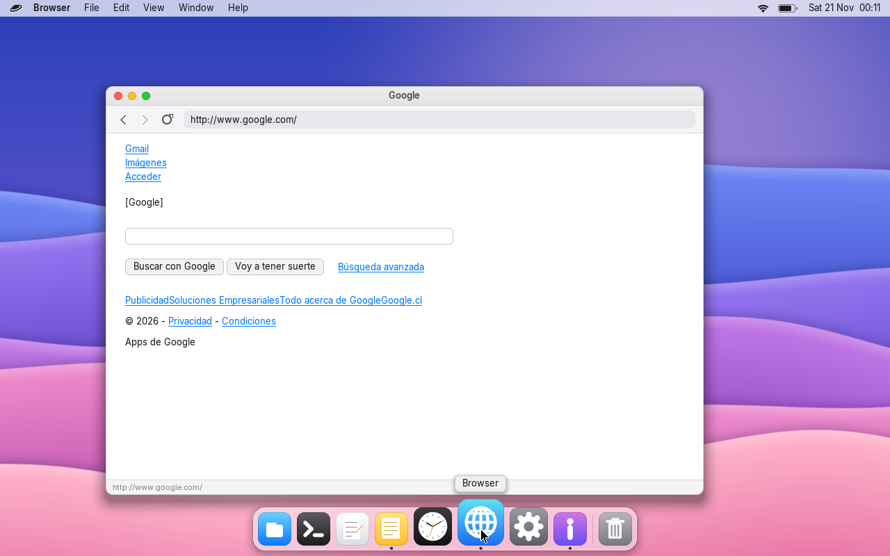

# myOS

*[Read in English](README.md)*

Un sistema operativo hobby escrito desde cero en **C y ensamblador** para **x86_64**, arrancado con [Limine](https://github.com/limine-bootloader/limine) y ejecutado en **QEMU**. No usa Linux ni un kernel prefabricado: cada capa (arranque, interrupciones, memoria, drivers, gráficos, ventanas y apps) se escribe en este repo. El único código de terceros está en `third_party/` (BearSSL para TLS y `stb_image` para imágenes), más las fuentes Inter y Spleen.

El proyecto se desarrolla con [Claude Code](https://claude.com/claude-code). Se avanza por fases pequeñas, cada una con verificación automática, y se usan varios agentes en paralelo que trabajan contra contratos de módulos bien definidos.


*El navegador de myOS mostrando google.com (formularios dibujados, tildes Latin-1).*

> **Estado:** las fases 0 a 13 del [plan](PLAN.md) están hechas. myOS arranca en BIOS y UEFI con un escritorio inspirado en macOS (barra superior, dock, ventanas con botones de colores), multitarea con desalojo, procesos en ring 3, pila TCP/IP con **HTTPS** (TLS 1.2 con validación de certificados), un VFS con disco FAT32 de lectura y escritura, y estas apps: Terminal, Archivos, Editor (tipo Bloc de notas), Navegador, Reloj, Notas, Ajustes y Acerca de. La documentación completa está en [docs/](docs/) (Markdown y PDF).

## Características

- [x] Arranque con Limine en BIOS y UEFI desde una ISO híbrida
- [x] Kernel en la mitad alta, `kprintf`, `panic`, consola serie, GDT/TSS, IDT, PIC y PIT a 1000 Hz
- [x] Gestor de memoria física, paginación de 4 niveles y heap con comprobaciones de corrupción
- [x] Teclado PS/2 (distribución US y Latinoamericana, `kbd us|latam`), ratón con rueda y reloj RTC
- [x] Compositor con doble buffer; escritorio estilo macOS, ventanas arrastrables y menús funcionales
- [x] Multitarea con desalojo, mutex y semáforos; procesos en ring 3, syscalls y cargador ELF
- [x] PCI, tarjeta e1000 y TCP/IP: ARP, IPv4, ICMP, UDP, DHCP, DNS, TCP y HTTP
- [x] **HTTPS**: cliente TLS 1.2 con BearSSL, 118 raíces de Mozilla y validación de certificados (rechaza autofirmados y vencidos)
- [x] Sistema de archivos: VFS, initrd (`/`), driver AHCI y FAT32 de lectura y escritura con nombres largos (`/disk`)
- [x] Apps: Terminal (ls, cat, cp, mv, rm, ping, fetch...), Archivos, Editor (selección, portapapeles, deshacer y rehacer, buscar), Ajustes y Acerca de
- [x] **Navegador**: HTTP y HTTPS, redirecciones, historial, HTML tolerante (enlaces, listas, tablas como texto, formularios dibujados), tildes Latin-1; abre Google, Wikipedia, Hacker News, BBC y más en un hilo de red, sin congelar la interfaz
- [x] Módulos de decodificación de imágenes (PNG, JPEG, GIF y BMP con `stb_image`) y de CSS, probados al arrancar; conectarlos al navegador está en curso
- [ ] Navegador: formularios y búsqueda, imágenes, CSS y peticiones POST. Sin JavaScript (el kernel no tiene coma flotante)
- [ ] Fase 14: apagado ACPI, animaciones y resolución configurable

## Requisitos (macOS con Apple Silicon o Intel)

```bash
brew install qemu nasm xorriso x86_64-elf-gcc x86_64-elf-binutils mtools
```

El binario de Limine (rama `v9.x-binary`) se descarga solo en el primer `make`.

> En un Mac con Apple Silicon, VirtualBox **no** puede ejecutar un OS x86. myOS corre en QEMU, que emula x86_64.

## Uso

| Comando | Qué hace |
|---|---|
| `make` | Compila `build/myos.iso` |
| `make run` | Abre myOS en una ventana de QEMU (BIOS), con el log serie en la terminal |
| `make run-uefi` | Igual, pero arranca con firmware UEFI (OVMF) |
| `make test` | Test sin pantalla en BIOS y UEFI; debe mostrar `PASS [bios]` y `PASS [uefi]` |
| `make screenshot` | Arranca sin pantalla y guarda `build/screenshot.png` (`WAIT=8` para esperar más) |
| `make qa` | Maneja el escritorio real por QMP con eventos de ratón y teclado y guarda capturas en `build/qa/` |
| `make debug` | Arranca en pausa con GDB en `:1234` y registra interrupciones y reinicios |
| `make clean` / `make distclean` | Borra `build/` (y `distclean` también `limine/`) |

### Cómo funcionan los tests

`make test` arranca una ISO aparte con `cmdline: test`. En ese modo el kernel ejecuta sus autotests, pinta unos cuantos frames del escritorio, escribe `[TEST] boot OK` por el puerto serie y apaga QEMU a través del dispositivo `isa-debug-exit`. El test pasa solo si QEMU termina con el código de salida esperado y el log contiene esa línea. Cada subsistema escribe su propia línea `[OK] ...` o detiene el arranque con `panic()`. Los logs quedan en `build/serial-*.log`.

## Estructura

```
kernel/
├── main.c            # kmain: orquesta la inicialización (fino a propósito)
├── boot.c            # peticiones a Limine (framebuffer, memmap, HHDM, cmdline)
├── linker.ld         # kernel en 0xffffffff80000000
├── include/          # contratos entre módulos: arch.h, mm.h, input.h, rtc.h, desktop.h...
├── lib/              # kprintf, string, panic, weak_stubs (implementaciones de reserva)
├── arch/x86_64/      # GDT, IDT, ISR, PIC, PIT
├── mm/               # PMM, VMM, heap
├── drivers/          # serie, PS/2, RTC, PCI, AHCI, e1000
├── fs/ net/ proc/    # VFS y FAT32, TCP/IP y cliente TLS, planificador y userspace
├── gfx/ wm/ apps/    # gráficos, gestor de ventanas, escritorio y apps (Navegador, Editor...)
third_party/          # BearSSL y stb_image (código de terceros, ver cada licencia)
tools/                # generadores de fuentes y de raíces CA, arnés de QA (qa_ui.py)
tests/                # boot_test.sh, screenshot.sh
limine.conf           # entrada normal
limine-test.conf      # entrada de test (cmdline: test)
```

Cada módulo implementa las funciones de su header en `kernel/include/`. `kernel/lib/weak_stubs.c` tiene versiones mínimas ("débiles") de todas esas funciones, así que cada módulo compila y se prueba por separado. Al enlazar, la implementación real sustituye siempre a la de reserva.

## Hoja de ruta

El plan completo, de la fase 0 a la 15 (multitarea, userspace en ring 3, FAT32, red TCP/IP, HTTPS y port a aarch64), está en [PLAN.md](PLAN.md). Las reglas de trabajo para agentes están en [CLAUDE.md](CLAUDE.md).

## Créditos

- [Limine](https://github.com/limine-bootloader/limine): bootloader y `limine.h` (protocolo Limine)
- [BearSSL](https://bearssl.org) (MIT): cliente TLS
- [stb_image](https://github.com/nothings/stb) (dominio público / MIT): decodificación de imágenes
- [Inter](https://rsms.me/inter/) (SIL OFL 1.1) y [Spleen](https://github.com/fcambus/spleen) (BSD-2-Clause): fuentes
- Bundle de certificados raíz de Mozilla (vía curl.se)
- Inspirado por el experimento "I Forced AI to Build a Custom Operating System" (The Render Guy), que creó AuroraOS
