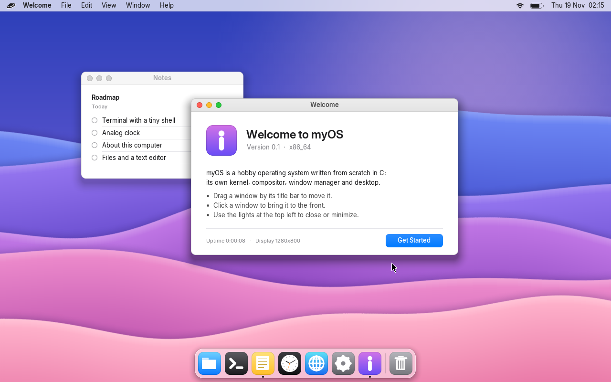
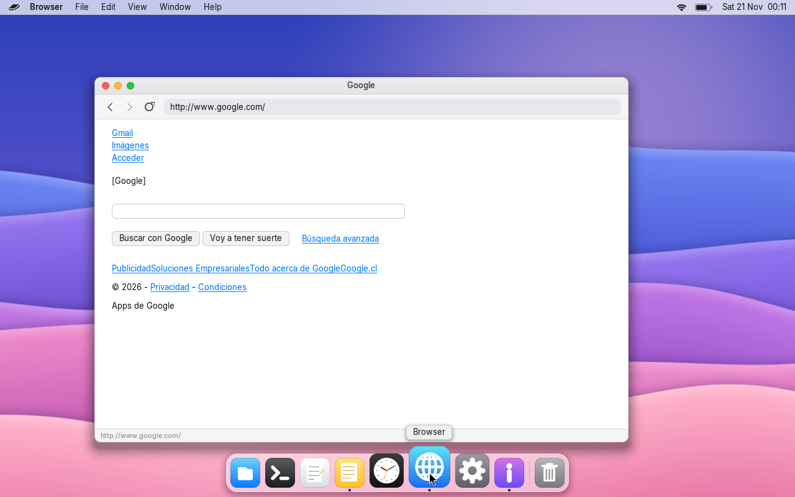

# myOS

*[Leer en español](README.es.md)*



A hobby operating system written from scratch in **C and assembly** for **x86_64**, booted by [Limine](https://github.com/limine-bootloader/limine) and run in **QEMU**. There is no Linux underneath and no prebuilt kernel: every layer, from boot and interrupts through memory, drivers, graphics and windows to the apps, is written in this repository. The only third-party code is vendored in `third_party/` (BearSSL for TLS, `stb_image` for image decoding) plus the Inter and Spleen fonts.

The project is built with [Claude Code](https://claude.com/claude-code). Work moves in small phases, each with automated verification, and several agents work in parallel against well-defined module contracts.


*The built-in Browser rendering google.com (forms drawn as controls, Latin-1 accents).*

> **Status:** phases 0 to 13 of the [plan](PLAN.md) are done. myOS boots on BIOS and UEFI into a macOS-inspired desktop (menu bar, frosted dock, windows with traffic-light buttons) with preemptive multitasking, ring 3 processes, a TCP/IP stack with **HTTPS** (TLS 1.2 with certificate validation), a VFS with a read/write FAT32 disk, and these apps: Terminal, Files, Editor (Notepad-style), Browser, Clock, Notes, Settings and About. See [docs/](docs/) for the full documentation (Spanish, Markdown + PDF).

## Features

- [x] Limine boot on BIOS and UEFI from a hybrid ISO
- [x] Higher-half kernel, `kprintf`, `panic`, serial console, GDT/TSS, IDT, PIC, 1000 Hz PIT
- [x] Physical memory manager, 4-level paging, kernel heap with corruption checks
- [x] PS/2 keyboard (US and Latin American layouts, `kbd us|latam`), PS/2 mouse with wheel, RTC clock
- [x] Double-buffered compositor that only redraws what changed; macOS-inspired desktop, draggable windows, working menus
- [x] Preemptive multitasking, mutexes, semaphores; ring 3 processes, syscalls, ELF loader
- [x] PCI, e1000 NIC, TCP/IP: ARP, IPv4, ICMP, UDP, DHCP, DNS, TCP, HTTP
- [x] **HTTPS**: BearSSL TLS 1.2 client, 118 Mozilla root CAs, certificate validation (self-signed and expired hosts are rejected)
- [x] Filesystem: VFS, initrd (`/`), AHCI SATA driver, FAT32 read/write with long names (`/disk`)
- [x] Apps: Terminal (ls, cat, cp, mv, rm, ping, fetch, ...), Files, Editor (selection, clipboard, undo/redo, find), Settings, About
- [x] **Browser**: HTTP and HTTPS, redirects, history, tolerant HTML layout (links, lists, tables as text, forms drawn as controls), Latin-1 accents, loads Google, Wikipedia, Hacker News, BBC and more on a background network thread so the UI never freezes
- [x] Image decoder module (PNG, JPEG, GIF, BMP via `stb_image`) and a CSS module, both tested at boot; wiring them into the Browser is in progress
- [ ] Browser: working forms/search, images, CSS, POST requests. No JavaScript (the kernel has no floating point)
- [ ] Phase 14: ACPI power off, animations, configurable resolution

## Requirements (macOS, Apple Silicon or Intel)

```bash
brew install qemu nasm xorriso x86_64-elf-gcc x86_64-elf-binutils mtools
```

The Limine binaries (branch `v9.x-binary`) are fetched automatically on the first `make`.

> On Apple Silicon, VirtualBox **cannot** run an x86 OS. myOS targets QEMU, which emulates x86_64.

## Usage

| Command | What it does |
|---|---|
| `make` | Builds `build/myos.iso` |
| `make run` | Opens myOS in a QEMU window (BIOS boot), serial log in the terminal |
| `make run-uefi` | Same, but boots with UEFI firmware (OVMF) |
| `make test` | Headless boot test on BIOS and UEFI; should print `PASS [bios]` and `PASS [uefi]` |
| `make screenshot` | Boots headless and saves `build/screenshot.png` (`WAIT=8` to wait longer) |
| `make qa` | Drives the real desktop through QEMU's QMP with mouse/keyboard events and saves screenshots in `build/qa/` |
| `make debug` | Starts paused with a GDB stub on `:1234` and interrupt/reset logging |
| `make clean` / `make distclean` | Removes `build/` (`distclean` also removes `limine/`) |

### How the tests work

`make test` boots a separate ISO whose kernel command line is `test`. In that mode the kernel runs its self-tests, renders a few desktop frames, prints `[TEST] boot OK` to the serial port and shuts QEMU down through the `isa-debug-exit` device. A run passes only if QEMU exits with the expected status code and the log contains that line. Each subsystem prints its own `[OK] ...` line or stops the boot with `panic()`. Logs are written to `build/serial-*.log`.

Sample output from a passing run:

```
myOS booting...
[OK] boot framebuffer 1280x800x32 cmdline='test'
[OK] mm total=238 MiB free=238 MiB
[OK] heap range=0xffffc00000000000..0xffffc11000000000
[OK] input ps2 kbd=yes mouse=yes wheel=yes
[OK] rtc 2026-11-19 01:51:29
[TEST] boot OK
```

## Project layout

```
kernel/
├── main.c            # kmain: brings up each subsystem in order (thin on purpose)
├── boot.c            # Limine requests (framebuffer, memmap, HHDM, cmdline)
├── linker.ld         # kernel linked at 0xffffffff80000000
├── include/          # module contracts: arch.h, mm.h, input.h, rtc.h, desktop.h...
├── lib/              # kprintf, string, panic, weak_stubs (fallback implementations)
├── arch/x86_64/      # GDT, IDT, ISRs, PIC, PIT
├── mm/               # PMM, VMM, heap
├── drivers/          # serial, PS/2 keyboard and mouse, RTC, PCI, AHCI, e1000
├── fs/ net/ proc/    # VFS + FAT32, TCP/IP + TLS client, scheduler + userspace
├── gfx/ wm/ apps/    # graphics, window manager, desktop and apps (Browser, Editor, ...)
third_party/          # BearSSL, stb_image (vendored, see each LICENSE)
tools/                # font and CA-root generators, QA harness (qa_ui.py)
tests/                # boot_test.sh, screenshot.sh
limine.conf           # normal boot entry
limine-test.conf      # test boot entry (cmdline: test)
```

Each module implements the functions declared in its header under `kernel/include/`. `kernel/lib/weak_stubs.c` provides minimal "weak" fallback versions of all of them, so any module can be built and tested on its own. When linking, the real implementation always replaces the fallback.

## Roadmap

The full plan, phases 0 to 15 (multitasking, ring 3 userspace, FAT32, TCP/IP networking, HTTPS and an optional aarch64 port), is in [PLAN.md](PLAN.md) (in Spanish). The working rules for coding agents are in [CLAUDE.md](CLAUDE.md).

## Credits

- [Limine](https://github.com/limine-bootloader/limine): bootloader and `limine.h` (Limine boot protocol)
- [BearSSL](https://bearssl.org) (MIT): TLS client
- [stb_image](https://github.com/nothings/stb) (public domain / MIT): image decoding
- [Inter](https://rsms.me/inter/) (SIL OFL 1.1) and [Spleen](https://github.com/fcambus/spleen) (BSD-2-Clause): fonts
- Mozilla CA certificate bundle (via curl.se): root certificates
- Inspired by the experiment "I Forced AI to Build a Custom Operating System" by The Render Guy, which produced AuroraOS
