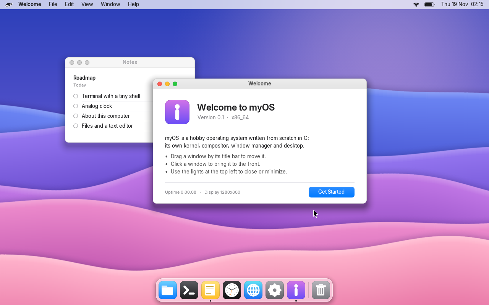

# 3. Módulos implementados

Cada módulo imprime su línea `[OK]` al arrancar. Más abajo hay un ejemplo del log completo.

## 3.1 Arranque y utilidades (`kernel/boot.c`, `kernel/lib/`)

- **Peticiones a Limine:** framebuffer, mapa de memoria, HHDM y línea de comandos, con la revisión base 3 del protocolo. `boot_is_test()` devuelve verdadero si la línea de comandos es `test`.
- **`kprintf` / `ksnprintf`:** formatos `%s %c %d %u %x %p`, con ancho y relleno con ceros.
- **`panic()`:** imprime `[FAIL] ...` por serie, cierra QEMU con código de error (en modo test) y detiene la CPU.
- **Driver serie COM1 (16550):** es el canal principal de logs y tests.

## 3.2 CPU e interrupciones (`kernel/arch/x86_64/`)

- **GDT:** segmentos nulo, código y datos del kernel, datos y código de usuario (DPL 3, en el orden que exige `sysret`), y un **TSS** con pilas IST separadas para el doble fallo y NMI.
- **IDT:** 256 entradas. Las rutinas de entrada en NASM (`isr.asm`) igualan el formato de todas las interrupciones, guardan los 15 registros y llaman a un despachador en C.
- **Excepciones:** muestran un volcado completo de registros (RIP, RSP, RFLAGS, CR0, CR2, CR3, CR4 y todos los generales). En los fallos de página decodifican CR2, y en los fallos de protección muestran el selector culpable. `int3` registra la dirección y continúa; se usa en el autotest.
- **PIC 8259:** reasignado a los vectores 32–47. `irq_register()` activa la línea, se manda el EOI correcto a maestro y esclavo, y se detectan las interrupciones espurias en IRQ7 e IRQ15.
- **PIT:** 1000 Hz con un contador de milisegundos de 64 bits. `timer_sleep_ms()` espera con `sti; hlt`.
- **Autotests:** se comprueba que `int3` vuelve, que el timer avanza (con límite para no colgarse) y que `sleep(20)` dura al menos 20 ms.

## 3.3 Memoria (`kernel/mm/`)

- **PMM:** un bitmap, un bit por página de 4 KiB. Solo usa memoria `USABLE` y nunca entrega la página 0. Detecta liberaciones dobles, desalineadas o fuera de rango.
- **VMM:** paginación de 4 niveles sobre las tablas de Limine. Respeta las páginas grandes de 2 MiB y 1 GiB, y hace `invlpg` en cada cambio.
- **Heap:** `kmalloc`, `kcalloc`, `krealloc` y `kfree` con alineación de 16 bytes.
  - Por debajo de 256 KiB usa una arena first-fit que divide y fusiona bloques.
  - A partir de 256 KiB, cada reserva va a su propio mapeo con una página de guarda.
  - Cada bloque lleva una cabecera con un número mágico, así que una liberación doble o un puntero inválido provocan `panic`.

## 3.4 Drivers (`kernel/drivers/`)

- **Controlador PS/2:** todas las esperas tienen límite, así que el sistema no se cuelga si falta el hardware.
- **Teclado:** set 1 de scancodes con teclas extendidas `E0`, distribución US, modificadores, bloqueo de mayúsculas y cola de 256 eventos.
- **Ratón:** IntelliMouse con rueda (paquetes de 4 bytes), resincronización y descarte de paquetes desbordados.
- **RTC (CMOS):** lectura doble estable, BCD o binario, formato de 12 o 24 horas, siglo y día de la semana.
- **PCI:** enumeración con el mecanismo 1, decodificación de BARs de 32 y 64 bits, `pci_enable()` y `mmio_map()`, que mapea memoria de dispositivos sin caché.
- **e1000:** soporta los chips Intel 82540EM, 82545EM y 82574L. Tiene 32 descriptores de recepción y 32 de transmisión en memoria accesible por DMA, y la recepción se consulta con `net_poll()`.

## 3.5 Red (`kernel/net/`)

| Capa | Qué tiene |
|---|---|
| Ethernet / ARP | Caché de 16 entradas, petición y respuesta |
| IPv4 / ICMP | Checksums, rutas a través del gateway, ping cliente y respuesta |
| UDP | Asociación de puertos con callbacks |
| DHCP | DISCOVER → OFFER → REQUEST → ACK |
| DNS | Registros A, nombres comprimidos, CNAME, reintentos y caché |
| TCP | Cliente, 8 conexiones, MSS, reenvío con espera que se duplica, ventana y FIN/RST |
| HTTP | `http_get()` HTTP/1.0 |

Todas las llamadas bloqueantes tienen tiempo límite y no dependen del scheduler. En QEMU se usa la red de usuario (slirp): IP `10.0.2.15`, gateway `10.0.2.2` y DNS `10.0.2.3`.

## 3.6 Multitarea y userspace (`kernel/proc/`)

- **Hilos del kernel:** `thread_create`, `thread_exit`, `thread_yield`, `thread_sleep_ms`, `thread_join` y `thread_list`. Este último está pensado para un futuro comando `ps`.
- **Scheduler:** round-robin con **desalojo** cada 10 ms gracias al PIT, más cesión voluntaria. Solo cambia de hilo al salir de una interrupción, después del EOI.
  - El cambio de contexto está en ensamblador (`switch.asm`).
  - Cada hilo tiene una pila de 16 KiB con un "canario" que detecta desbordamientos.
  - Un hilo ocioso hace `hlt` y libera los hilos terminados.
- **Sincronización:** spinlocks (también en versión que guarda el estado de interrupciones), mutex bloqueante, semáforos, variables de condición y colas de espera.
- **`timer_sleep_ms`:** bloquea solo al hilo que lo llama, así el bucle del escritorio deja correr a los demás.
- **Ring 3:**
  - Cada proceso tiene su propio espacio de direcciones.
  - Las llamadas al sistema usan `syscall`/`sysret`: `write`, `exit`, `yield`, `sleep` y `getpid`.
  - Un cargador ELF ejecuta programas de `user/` compilados aparte.
  - Si un proceso de usuario provoca una excepción, **solo ese proceso muere** y el kernel sigue funcionando.
- **Memoria concurrente:** el PMM, el VMM y el heap protegen sus secciones críticas desactivando interrupciones, de forma anidable.
- **Autotests:**
  - Un contador compartido por 3 hilos bajo mutex tiene que dar 600.
  - Un hilo que nunca cede no puede bloquear al hilo principal.
  - La precisión de `sleep` tiene que estar dentro de márgenes.
  - Los hilos terminados se liberan.
  - Un programa en ring 3 imprime `hello from ring 3` y termina con código 42; otro que escribe en memoria del kernel es eliminado.

## 3.7 Escritorio estilo macOS (`kernel/gfx/`, `kernel/wm/`, `kernel/apps/`)



- **Gráficos (`gfx`):** superficies, rectángulos redondeados con bordes suavizados, transparencias, degradados y círculos. El texto se dibuja con bordes suavizados usando la fuente **Inter** (licencia OFL) en 11, 13 y 24 px; se convierte a mapa de bits con `tools/ttf2c.py`. Para la futura terminal se incluye además la fuente **Spleen** (BSD-2).
- **Compositor:** doble buffer, wallpaper en caché y **redibujado solo de las zonas que cambian**. Copia al framebuffer línea a línea respetando el `pitch`.
- **Vidrio esmerilado barato:** las franjas del wallpaper detrás de la barra de menú y del dock se difuminan y tiñen **una sola vez** al arrancar. Después dibujarlas es solo copiar, sin difuminar en cada frame.
- **Barra de menú (24 px):** logo propio de myOS (un planeta con órbita), con menú desplegable; el nombre de la app activa; los menús File, Edit, View, Window y Help; y a la derecha, iconos de Wi-Fi y batería y la fecha y hora del RTC.
- **Dock:** flotante y translúcido, con 8 iconos dibujados por código, **efecto lupa** al pasar el ratón, etiqueta con el nombre, punto bajo las apps abiertas y separador antes de la papelera.
- **Ventanas:** esquinas de 10 px, sombra suave, borde de 1 px y barra de título de 28 px con el título centrado. Los **botones de semáforo** (cerrar, minimizar, zoom) muestran sus símbolos al pasar el ratón y se vuelven grises en las ventanas inactivas. Se pueden enfocar, arrastrar, cerrar, minimizar y restaurar desde el dock.
- **Apps de ejemplo:** *Welcome*, con el tiempo encendido y el botón *Get Started*, y *Notes*.
- Todos los colores y medidas están en `kernel/wm/theme.h`, que incluye también una paleta oscura para el futuro. No se usa nada de Apple: el logo, los iconos y el wallpaper son propios.

## Log de un arranque completo (modo test)

```
myOS booting...
[OK] boot framebuffer 1280x800x32 cmdline='test'
[OK] arch gdt/idt/pic/pit
[OK] mm total=238 MiB free=238 MiB
[OK] heap range=0xffffc00000000000..0xffffc11000000000
[OK] pci 6 devices
[OK] sched mutex counter=600 (contended 75), sem/cond handshake
[OK] sched preempt: hog ran 15301085 loops, sleep(10)=10ms, sleep(20) under load=20ms
[OK] sched reaped 6 threads, 2 left, 205 switches, test took 77 ms
hello from ring 3
[OK] user ring3: pid 8 exit=42 via syscalls, faulting pid 9 killed, address spaces freed
[OK] input ps2 kbd=yes mouse=yes wheel=yes
[OK] rtc 2026-11-19 02:12:41
[OK] net e1000 mac=52:54:00:12:34:56 model=82540EM link up
[OK] dhcp ip=10.0.2.15 mask=255.255.255.0 gw=10.0.2.2 dns=10.0.2.3
[OK] arp 10.0.2.2 is 52:55:0a:00:02:02
[OK] ping 10.0.2.2 rtt=2ms
[OK] dns example.com=172.66.147.243
[OK] http GET example.com -> HTTP/1.1 200 OK
[OK] desktop 1280x800, compositor + wm + shell, 2 window(s)
[TEST] boot OK
```
