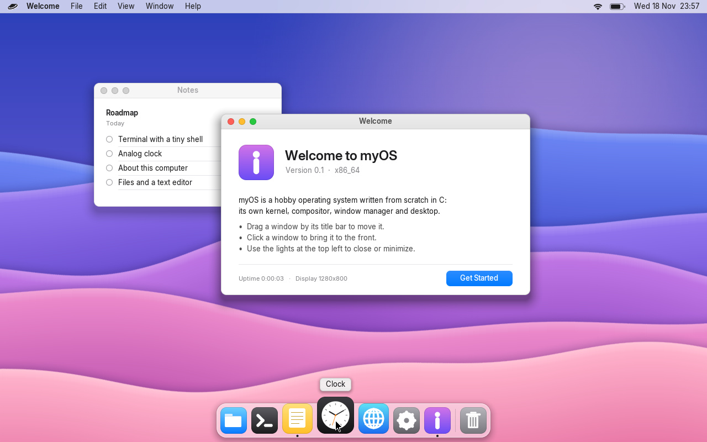
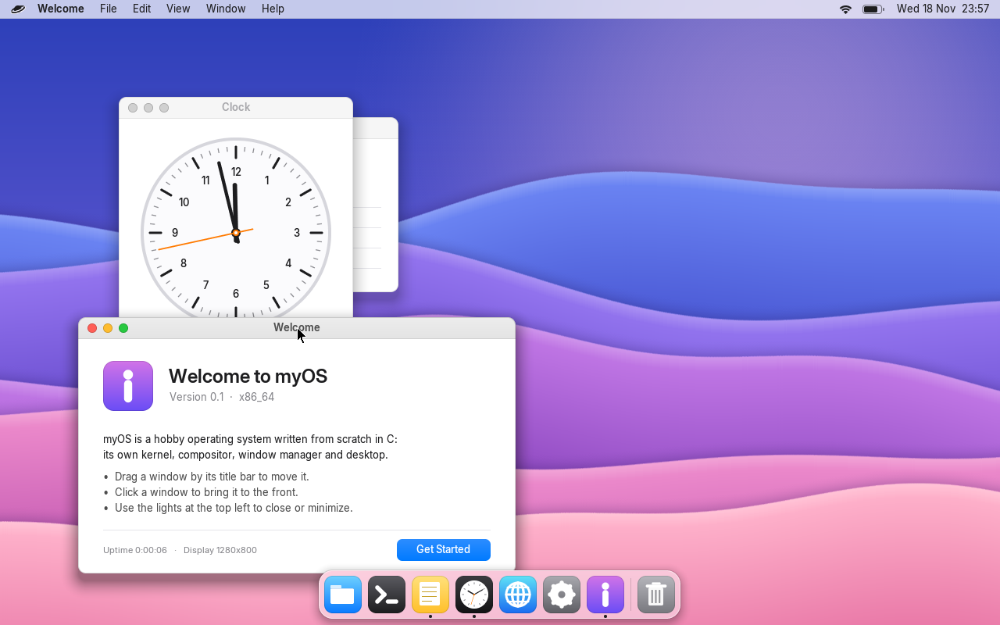
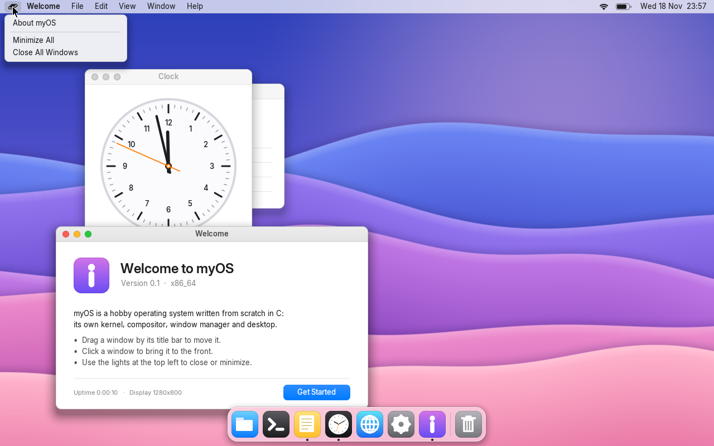
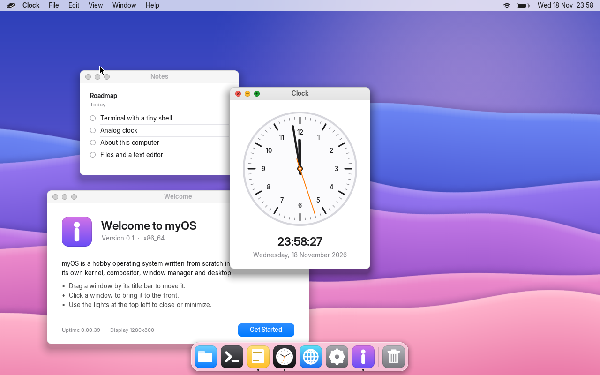

# 7. Informe de QA

*QA realizado el 19 de noviembre de 2026 sobre `main`, con todos los subsistemas integrados y la app Reloj incluida.*

## Resumen

| Área | Resultado |
|---|---|
| Autotests al arrancar (BIOS y UEFI) | ✅ 23 de 23 `[OK]` |
| Repetibilidad de `make test` | ✅ 3 de 3 ejecuciones en verde |
| Clon limpio desde GitHub + `make test` | ✅ Compila y pasa: Limine se descarga solo |
| Interfaz con ratón y teclado PS/2 reales | ✅ 17 pasos, sin fallos |
| Estabilidad (≈ 45 s de uso y 25 clics rápidos) | ✅ Sin `panic` ni excepciones inesperadas |
| Tiempo de arranque | 2,5 s hasta el escritorio (antes 2,8 s) |

**No se encontraron fallos bloqueantes.** Las únicas excepciones del log son las provocadas a propósito por el autotest de ring 3: se lanza un proceso que escribe en memoria del kernel y debe morir sin tumbar el sistema.

## Cómo se hizo

`make qa` ejecuta [tools/qa_ui.py](../tools/qa_ui.py), que hace lo siguiente:

1. Arranca la ISO normal (no la de test) sin pantalla, con disco, red y QMP.
2. Espera la línea `[OK] desktop`.
3. Inyecta eventos **reales** de ratón y teclado PS/2 con `input-send-event`. Recorren el mismo camino que un usuario: IRQ12/IRQ1 → driver → cola de eventos → gestor de ventanas.
4. Guarda una captura PNG después de cada paso en `build/qa/` y revisa el log serie al terminar.

## Pruebas de interfaz

| # | Acción | Resultado esperado | Estado |
|---|---|---|---|
| 1 | Arranque | Escritorio con Welcome y Notes | ✅ |
| 2 | Mover el ratón al icono del Reloj | El cursor baja (eje Y correcto); lupa en el dock y etiqueta "Clock" | ✅ |
| 3 | Clic en el icono del Reloj | Se abre la ventana Clock y la barra de menú muestra "Clock" | ✅ |
| 4 | Arrastrar Welcome por su título (-300, +200) | La ventana se desplaza exactamente eso | ✅ |
| 5 | Clic sobre una ventana de fondo | La ventana pasa al frente y se enfoca | ✅ |
| 6 | Restaurar Welcome desde el dock | Welcome al frente | ✅ |
| 7 | Clic en el logo de myOS | Menú: About myOS, Minimize All, Close All Windows | ✅ |
| 8 | Esc + clic fuera | El menú se cierra | ✅ |
| 9 | Escribir "hello" + Enter | Sin efectos ni cuelgues (ninguna app usa el teclado todavía) | ✅ |
| 10 | 25 clics seguidos en el icono del Reloj | Sigue una sola ventana, sin fallos | ✅ |
| 11 | Esperar 3 s | El segundero y la hora digital avanzan | ✅ |
| 12 | Botón rojo del Reloj | La ventana se cierra | ✅ |
| 13 | Botón amarillo | La ventana se minimiza | ✅ |
| 14 | Clic en el dock | La ventana se restaura | ✅ |
| 15 | Botón verde | La ventana se recentra (el zoom actual solo recentra) | ✅ |
| 16 | Botón "Get Started" de Welcome | Welcome se cierra | ✅ |

| Hover en el dock | Ventana arrastrada |
|---|---|
|  |  |
| **Menú del logo** | **Zoom (verde) del Reloj** |
|  |  |

## Observaciones y deuda conocida

| Severidad | Hallazgo | Propuesta |
|---|---|---|
| ~~Media~~ ✅ | **La red no se atendía después del arranque** porque nadie llamaba a `net_poll()` | **Corregido:** `desktop_frame()` llama a `net_poll()` en cada frame. Verificado abriendo una conexión TCP desde el Mac por `hostfwd`: myOS responde en 19 ms (la primera conexión tarda unos 5 s mientras slirp se pone en marcha) |
| ~~Media~~ ✅ | Los autotests de disco y red corrían en **todos** los arranques: escribían en `/disk/selftest` y salían a Internet | **Corregido:** el autotest de escritura en FAT32 y el de ping, DNS y HTTP solo corren en modo test (`make test` los sigue ejecutando todos). El arranque normal pasa de 2,8 a **2,5 s**. El segundo que queda en DHCP se debe a la autonegociación simulada de la e1000 de QEMU, que descarta los dos primeros DISCOVER; los reintentos ahora son rápidos (200, 400 y 800 ms) |
| Baja | `kprintf` no tiene lock: las líneas de distintos hilos pueden mezclarse | Spinlock con interrupciones desactivadas en el driver serie |
| Baja | El botón verde (zoom) solo recentra la ventana, porque el buffer de cada ventana tiene tamaño fijo | Permitir redimensionar buffers con `krealloc` |
| Baja | Los menús File, Edit, View, Window y Help no tienen acciones | Fase 11 (apps) |
| Baja | La resolución es fija, 1280×800; QEMU solo escala la imagen | Resolución configurable en `limine.conf` o virtio-gpu (fase 14) |
| Info | Con UEFI, OVMF escribe `NvVars` en el disco FAT32 | Inofensivo: los tests usan una copia nueva del disco |

## Fase 11: apps base

`make qa` ahora abre desde el dock Archivos, Terminal (`ls`, `pwd`), Editor (escribe texto), Ajustes y Acerca de (desde el menú del logo), con capturas 18 a 24 y el log serie sin problemas. El arnés ignora la excepción intencional del autotest de ring 3 (`user/faulty`), que antes aparecía como falso positivo. Las coordenadas del dock se movieron porque ahora tiene 9 iconos.

Sin probar en pantalla: `fetch` en la Terminal, scroll con rueda en Editor y Archivos, y el paso de Archivos al Editor al abrir un archivo.
