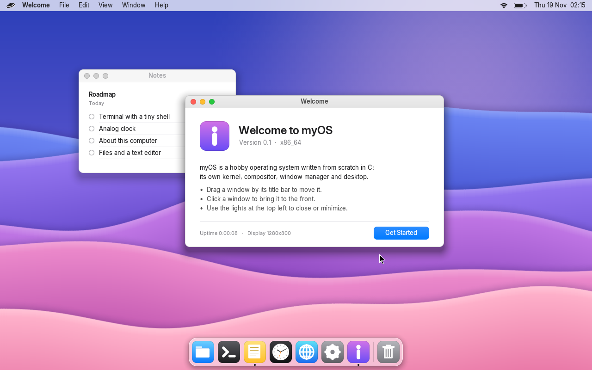

# Documentación de myOS

Esta carpeta explica cómo se está construyendo myOS: qué se decidió, cómo está organizado el código, qué hace cada módulo, cómo se prueba y en qué punto está el proyecto.

| # | Documento | De qué trata |
|---|---|---|
| 1 | [Visión y estrategia](01-vision-y-estrategia.md) | De dónde sale el proyecto, objetivos y decisiones técnicas |
| 2 | [Arquitectura](02-arquitectura.md) | Arranque, mapa de memoria, módulos y contratos |
| 3 | [Módulos implementados](03-modulos.md) | Qué hace cada parte del kernel y cómo |
| 4 | [Build, tests y depuración](04-build-y-tests.md) | Toolchain, Makefile, tests automáticos y capturas |
| 5 | [Metodología multi-agente](05-metodologia-multiagente.md) | Cómo se reparte el trabajo entre agentes de Claude Code |
| 6 | [Estado y avance](06-estado-y-avance.md) | Qué está hecho, qué está en curso y el porcentaje de avance |

**Presentación:** [`myOS-arquitectura.pptx`](myOS-arquitectura.pptx), 15 diapositivas con la arquitectura y los pasos de construcción, y notas del orador en cada una. Se genera con `tools/build_deck.js` (pptxgenjs).

Hay una versión PDF de cada documento en [`pdf/`](pdf/), además de un PDF único con todo: [`pdf/myOS-documentacion.pdf`](pdf/myOS-documentacion.pdf).

